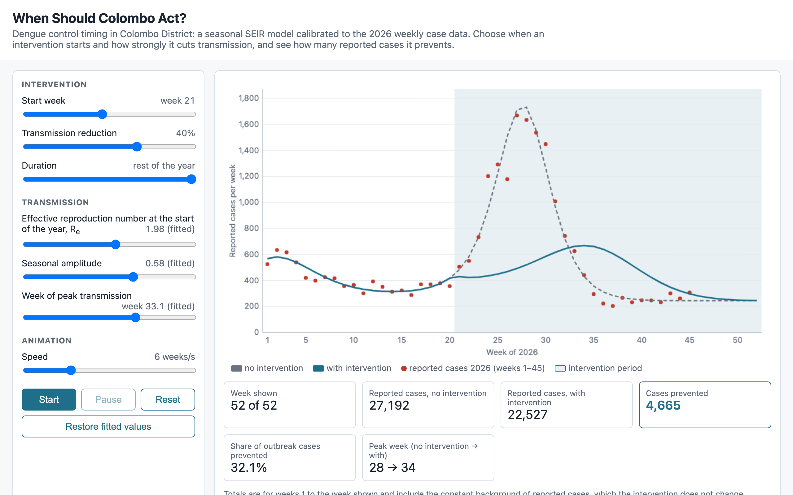
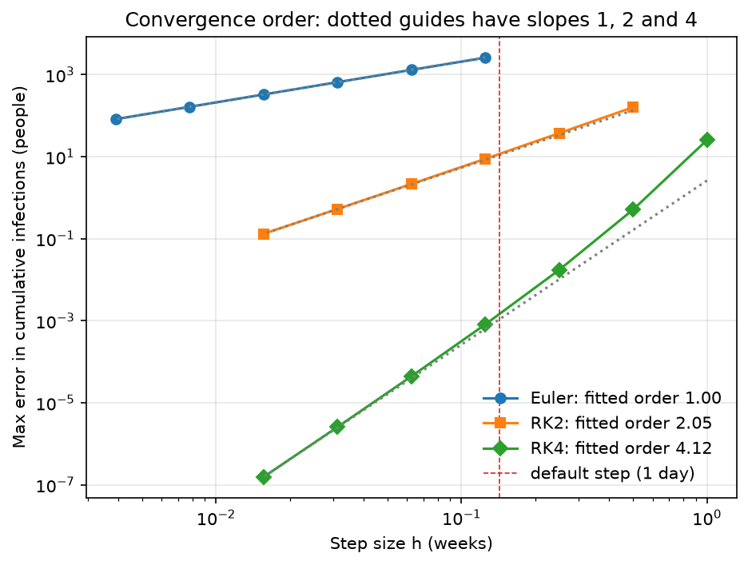
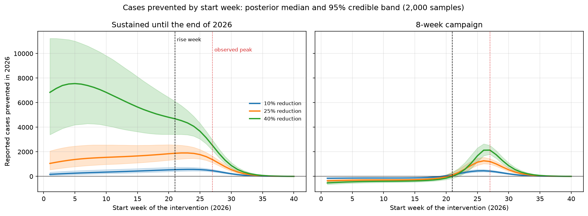

# When Should Colombo Act? Simulating Dengue Outbreak Control Timing

A seasonal SEIR model of dengue in Colombo District, Sri Lanka, calibrated to the 2026 weekly case data with Bayesian MCMC. It estimates how many reported cases an intervention prevents when it starts earlier rather than later.

**[Live demo](https://it23226814.github.io/colombo-dengue-control-timing/)** · [](https://colab.research.google.com/github/IT23226814/colombo-dengue-control-timing/blob/main/notebook/colombo-dengue-control-timing.ipynb)



## The problem

Dengue is a major public-health problem in Sri Lanka, and Colombo District is densely populated. In 2026, weekly suspected cases rose from about 300 in April to a peak of 1,668 in week 27 (early July), after the south-west monsoon rains. Health officials must decide **when** to start vector-control and clean-up campaigns. Acting early uses resources before the outbreak is visible. Acting late can mean thousands of extra cases.

This project asks: *if an intervention cuts dengue transmission by a given percentage, how many reported cases does it prevent when it starts in a given week rather than later?* The answer comes as cases prevented, with 95% credible intervals, for every start week and several strengths. It is based on a model fitted to the 45 weeks of 2026 data published by the National Dengue Control Unit.

## Quick start

**Notebook:** click the *Open in Colab* badge above, then *Runtime → Run all*. It installs what it needs and runs top to bottom in about 5 minutes (measured on a laptop; the notebook stops with an error if it takes longer than 10 minutes). The data are read from this repository, and every random number comes from one fixed seed, so the results are the same on every run.

**Web demo:** open the [live demo](https://it23226814.github.io/colombo-dengue-control-timing/), or download this repository and double-click `docs/index.html`.

**Run locally (optional):**

```bash
pip install -r requirements.txt notebook pytest
jupyter notebook notebook/colombo-dengue-control-timing.ipynb
python -m pytest -q          # 39 automated tests of the model, sampler, notebook and demo
```

## Using the demo

**Controls.**
- Choose the **start week**, the **transmission reduction** (0–60%) and the **duration** of an intervention.
- Optionally change the transmission settings: reproduction number, seasonal amplitude and peak week.
- Press **Start** to replay 2026 week by week.

**What it shows.**
- The chart shows weekly reported cases without the intervention (grey) and with it (blue), against the cases actually reported in 2026 (red dots).
- The boxes give the totals, the **cases prevented** and the share of the outbreak prevented.

Full guide: [USER_GUIDE.md](USER_GUIDE.md).

## Model and mathematics

People are divided into susceptible $S$, exposed $E$, infectious $I$ and recovered $R$. Transmission varies with the season and is cut by the intervention:

$$
\frac{dS}{dt} = -\beta(t)\frac{SI}{N},\quad
\frac{dE}{dt} = \beta(t)\frac{SI}{N} - \sigma E,\quad
\frac{dI}{dt} = \sigma E - \gamma I,\quad
\beta(t) = \beta_0\Big[1 + a\cos\frac{2\pi(t-\phi)}{52}\Big]\,u(t),
$$

Here $u(t) = 1 - r$ while the intervention is active. Reported cases are a fraction $\rho$ of new infections, plus a constant background $b$, and are modelled as negative binomial.

**Numerical method.** The equations are solved with a hand-written fourth-order Runge–Kutta (RK4) method using a one-day step.

**Calibration.** The unknown parameters ($R_e$, $a$, $\phi$, $\rho$, $s_0$, $I_0$, the dispersion and $b$) are estimated by a hand-written random-walk Metropolis MCMC sampler with 16 chains. Its priors come from the literature.

**Scenarios.** Uncertainty is carried into the scenarios by running every scenario over 2,000 posterior samples.

Full derivations, assumptions and parameters: [THEORY.md](THEORY.md). Executable version: the [notebook](notebook/colombo-dengue-control-timing.ipynb).

## Verification

Every check is an `assert` in the notebook, so *Run all* stops if one fails.

- **Conservation.** Over 200 random parameter sets, $S+E+I+R$ stays equal to $N$ to within $4\times10^{-15}$ (relative).
- **Limiting case.** With $R_0 < 1$ infections decline and stay below the branching-process bound, while the control run with $R_0 = 1.5$ produces an outbreak.
- **Convergence order.** Against an independent 8th-order reference solution, RK4 converges at order **4.12**, against the theoretical 4; Euler and RK2 give 1.00 and 2.05 (figure below). At the one-day step the error is 0.0015 people.
- **Parameter recovery.** On synthetic data with known parameters, the sampler recovers all 8 true values inside their 95% credible intervals.
- **Real-data fit.** The fit to 2026 converges (split-$\hat R \le 1.008$), and 43 of the 45 observed weeks fall inside the 95% posterior predictive band.
- **Robustness of the scenarios.** The scenario results do not change with a 4× smaller step. They are not merely deferred into 2027. Their Monte Carlo error is below 2% of the credible-interval width.

**Web demo against the notebook.** The demo runs the same model in JavaScript. For a reference scenario it shows its result beside the notebook's: the fitted (highest-posterior) parameters, with a 40% cut from week 21 to the end of the year. Both give **4,665.2 reported cases prevented**. The stated tolerance is 1%, and the two agree to better than 0.0001%. The notebook (Section 5.5) checks that the demo uses the same parameter set. `tests/test_demo.py` runs the JavaScript model and compares every weekly value with the Python model.



The full table of checks is in [THEORY.md](THEORY.md#5-verification).

## Concepts applied

This project applies a compartmental (SEIR) epidemic model with periodic seasonal forcing, and a host–vector extension driven by environmental data. The model's ordinary differential equations are solved with the classical fourth-order Runge–Kutta method, and the solver's order of convergence is verified against a high-accuracy reference, together with a conservation law and a threshold limiting case. The parameters are estimated by Bayesian inference: a negative-binomial likelihood, priors on transformed scales with Jacobian corrections, and a random-walk Metropolis Markov chain Monte Carlo sampler with adaptive tuning, checked by split-$\hat R$, effective sample size, recovery of known parameters and posterior predictive checks. Parameter uncertainty is propagated into the scenarios by Monte Carlo simulation over posterior samples, giving credible intervals and paired comparisons. Sensitivity is examined by re-calibration under alternative assumptions, one-at-a-time comparisons and partial rank correlation coefficients with bootstrap intervals.

## Results



**Model fit.** The fitted model reproduces the 2026 season well: 43 of 45 weeks lie inside the 95% predictive band, and the predicted peak is in week 28 against week 27 observed. Transmission at the start of the year was $R_e \approx 1.96$ (95% CrI 1.78–2.14), rising to about 3.1 at the seasonal peak.

**Why the outbreak ended.** It ended because a small at-risk population was used up, about 7% of the district, not because the season ended. This shapes every result. Without an intervention, the model gives 14,502 (13,157–15,985) outbreak cases in 2026, on top of a steady background of about 247 cases per week.

All figures below are reported cases prevented in 2026, median (95% credible interval):

| Intervention | Start in week 5 | Start at the rise (week 21) | Week 25 | Week 29 |
|---|---|---|---|---|
| 40% cut, rest of the year | 7,554 (4,198–11,009) | **4,689 (3,418–6,108)** | 3,673 (3,040–4,321) | 1,324 (1,056–1,622) |
| 25% cut, rest of the year | 1,376 (790–2,463) | 1,880 (1,369–2,560) | 1,774 (1,420–2,186) | 791 (625–979) |
| 40% cut, 8-week campaign | −444 (−558 to −337) | −4 (−163 to 333) | 1,673 (1,181–2,318) | 1,288 (1,031–1,569) |

**The answer.**

- **Strong sustained cut.** For a 40% cut kept up for the rest of the year, **earlier is clearly better**. Started at the rise it prevents about a third of the outbreak, and started in the early months about half. **Each week of delay after the rise costs about 256 (86–460) reported cases per week in weeks 21–25, and 586 (485–684) per week in weeks 25–29.**
- **Weak or short measures.** These are worth much less, and their benefit depends on hitting the outbreak itself (weeks 23–27) rather than on starting as early as possible.

**Sensitivity.**
- **Robust:** the direction of these conclusions holds across all the inputs varied in the sensitivity analysis.
- **Uncertain:** their size depends mostly on the real strength of the intervention and on the assumed incubation and infectious periods. Over plausible incubation and infectious periods, the cases prevented range from about 0.7 to 1.4 times the central estimate.
- **Model-dependent:** a rainfall-driven model with explicit mosquitoes agrees that a strong cut should start at or before the rise, and that a short campaign should be timed just before the peak. It does **not** support the finding that early weak or short measures *add* cases, so that finding should be read as specific to the cosine-season model.

## Limitations and future work

- **One season, small at-risk pool.** The data come from a single season. They pin down the product of the reporting rate and the susceptible fraction, but not each one separately. A homogeneous model represents transmission concentrated in some neighbourhoods as a small, well-mixed population. Fitting several seasons, or district-level data from the high-risk Medical Officer of Health areas, would separate these.
- **Structure matters.** The host-only model with a cosine season and the rainfall-driven host–vector model disagree about early and weak measures. A spatial or multi-district model, and climate drivers such as temperature, are the natural next steps.
- **A generic intervention.** The intervention is a single percentage cut in transmission. Linking specific measures (larval source reduction, fogging, community clean-ups) to their effect sizes and costs would turn cases prevented into a cost-effectiveness comparison.
- **Suspected cases.** The data are suspected cases with a constant reporting rate. Laboratory-confirmed data, or changes in reporting over time, would refine the observation model.

## Key references

1. National Dengue Control Unit, Ministry of Health, Sri Lanka, "Weekly Dengue Update," 2026, weeks 1–45. [Online]. Available: https://www.dengue.health.gov.lk/weekly-report/
2. M. J. Keeling and P. Rohani, *Modeling Infectious Diseases in Humans and Animals*. Princeton University Press, 2008, doi: 10.1515/9781400841035.
3. M. Chan and M. A. Johansson, "The incubation periods of dengue viruses," *PLoS ONE*, vol. 7, no. 11, p. e50972, 2012, doi: 10.1371/journal.pone.0050972.
4. E. A. Undurraga, Y. A. Halasa and D. S. Shepard, "Use of expansion factors to estimate the burden of dengue in Southeast Asia: a systematic analysis," *PLoS Neglected Tropical Diseases*, vol. 7, no. 2, p. e2056, 2013, doi: 10.1371/journal.pntd.0002056.
5. A. Gelman *et al.*, *Bayesian Data Analysis*, 3rd ed. Chapman and Hall/CRC, 2013, doi: 10.1201/b16018.

Full list: [REFERENCES.md](REFERENCES.md).

## AI assistance

Developed with the help of AI coding and writing assistants. All code was reviewed, run and verified by the author.

## Licence and credits

Code: [MIT](LICENSE).

**Data:**
- Weekly dengue cases: National Dengue Control Unit, Ministry of Health, Sri Lanka, *Weekly Dengue Update* reports (public government reports, reproduced as aggregated counts with attribution).
- Population: Department of Census and Statistics, Sri Lanka, *Census of Population and Housing 2024*.
- Rainfall: [Open-Meteo.com](https://open-meteo.com/), historical weather API (ERA5-based reanalysis), CC BY 4.0.

Details and build scripts are in [data/README.md](data/README.md).
