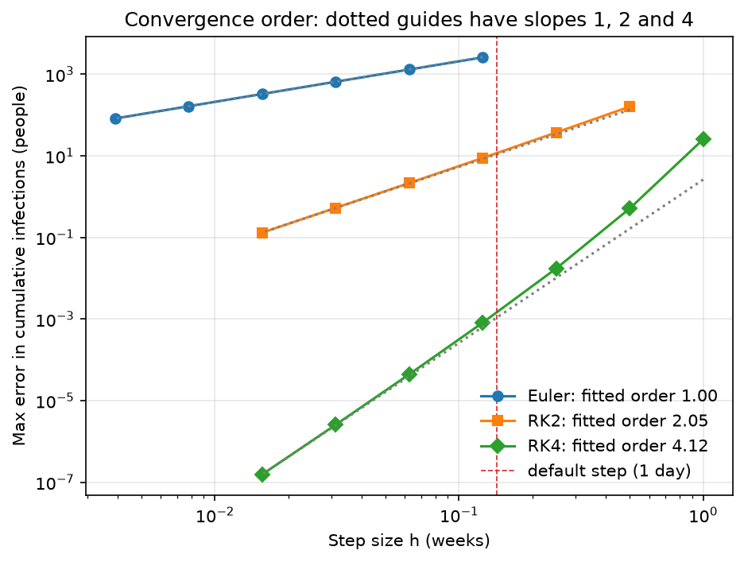
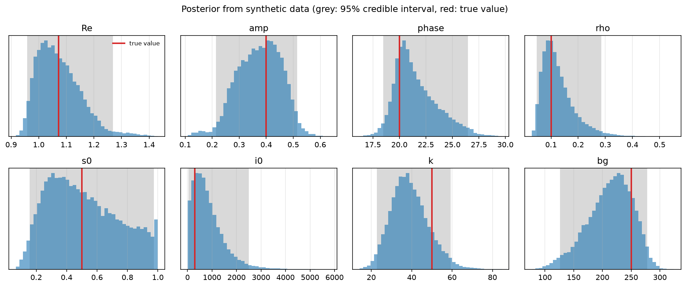

# Theory and mathematics

This document gives the mathematics behind the simulation: the model, the numerical solver, the Bayesian calibration, the verification checks and how uncertainty is carried into the results. The executable version of everything here is the notebook [`notebook/colombo-dengue-control-timing.ipynb`](notebook/colombo-dengue-control-timing.ipynb); section numbers in brackets, such as (§3.4), refer to it. Reference numbers [n] follow the notebook's Section 7 and [REFERENCES.md](REFERENCES.md).

## 1. Problem formulation

**System.** Dengue transmission in Colombo District, Sri Lanka (population $N = 2{,}375{,}415$ [2]), during 2026. The data are the weekly numbers of suspected dengue cases notified in the district, weeks 1–45 of 2026 (25,511 cases), taken from the National Dengue Control Unit's weekly reports [1].

**Question.** *If an intervention reduces dengue transmission by a fraction $r$, how many reported cases does it prevent when it starts in week $w$ rather than later?*

**Quantities of interest.**

| Quantity | Definition |
|---|---|
| Cases prevented $\Delta(w, r)$ | Reported outbreak cases in weeks 1–52 without the intervention, minus those with it (§5.1) |
| Cost of delay | $[\Delta(w, r) - \Delta(w+4, r)]/4$, extra cases per week of postponement (§5.2) |
| Best start week | $\arg\max_w \Delta(w, r)$ |

Each is reported as a posterior median with a 95% credible interval (CrI).

## 2. Assumptions

1. **Homogeneous mixing** within the district, with no movement between districts. This is the standard simplest assumption, and it is the reason the fitted susceptible fraction is small (§3.4): transmission concentrated in some neighbourhoods appears as a small, well-mixed population.
2. **Host-only transmission.** Many dengue models include the mosquito explicitly [12, 13]. Here the mosquito stage, including the 8–12 day extrinsic incubation [4], is absorbed into the transmission rate $\beta(t)$. Section 5.4 of the notebook relaxes this with an explicit host–vector model (see §3.5 below).
3. **Seasonality** is a single annual cosine in $\beta$ (sinusoidal forcing [11]), standing in for rainfall- and temperature-driven mosquito abundance.
4. **Immunity.** Only a fraction $s_0$ of the population is susceptible at the start of the year. Recovery gives immunity for the rest of the season, and serotypes are not distinguished. Over one season births, deaths and waning immunity are negligible.
5. **Reporting.** Reported cases are a fixed fraction $\rho$ of new symptomatic infections, plus a constant background $b$ per week. The background covers cases the single-season dynamics do not produce: endemic pockets, imported infections, and suspected cases that are not dengue. Reporting delays are ignored, because the series uses revised weekly counts.
6. **Intervention.** Any combination of measures is summarised as a fractional cut $r$ in transmission between a start and an end week.
7. **Fixed periods.** The intrinsic incubation period (5.9 days [3]) and the infectious period (5 days [4]) are fixed at literature values. Their effect is tested in the sensitivity analysis (§5.3).

## 3. Model equations

### 3.1 Seasonal SEIR model

The model is a seasonal SEIR compartmental model, a standard extension of the Kermack–McKendrick epidemic model [10, 11].

Time $t$ is in **weeks**. The state variables (all in people) are $S$ susceptible, $E$ exposed (infected, not yet infectious), $I$ infectious, $R$ recovered or immune, and $C$, the cumulative number of new symptomatic infections.

$$
\begin{aligned}
\frac{dS}{dt} &= -\beta(t)\,\frac{S I}{N}, &
\frac{dE}{dt} &= \beta(t)\,\frac{S I}{N} - \sigma E, &
\frac{dI}{dt} &= \sigma E - \gamma I, \\
\frac{dR}{dt} &= \gamma I, &
\frac{dC}{dt} &= \sigma E, &
N &= S + E + I + R .
\end{aligned}
$$

**Initial state at $t = 0$** (start of week 1). $I(0) = I_0$, $E(0) = E_0 = I_0\gamma/\sigma$ (the ratio at which $E$ and $I$ are in balance when incidence is roughly steady), $S(0) = s_0 N - E_0 - I_0$, $R(0) = N - S(0) - E_0 - I_0$ and $C(0) = 0$.

### 3.2 Seasonal forcing and intervention

$$
\beta(t) = \beta_0\left[1 + a\cos\!\left(\frac{2\pi(t-\phi)}{52}\right)\right]u(t),
\qquad
u(t) = \begin{cases} 1 - r, & t_{\text{start}} \le t < t_{\text{end}}, \\ 1, & \text{otherwise.}\end{cases}
$$

Here $a \in [0, 1)$ keeps $\beta > 0$, and $\phi$ is the week of peak transmission. An intervention starting in week $w$ has $t_{\text{start}} = w - 1$. A sustained intervention has $t_{\text{end}} = \infty$; an 8-week campaign has $t_{\text{end}} = t_{\text{start}} + 8$.

**Reproduction numbers.** For a fully susceptible population, $R_0(t) = \beta(t)/\gamma$. The calibration uses the **effective reproduction number at the start of the year**,

$$
R_e = \frac{\beta_0\, s_0}{\gamma}, \qquad\text{so}\qquad \beta_0 = \frac{R_e\,\gamma}{s_0}.
$$

The seasonal peak value is $R_e(1+a)$.

### 3.3 Observation model and likelihood

New symptomatic infections in week $k$ (from $t = k-1$ to $t = k$) are $C(k) - C(k-1)$. The expected number of reported cases is

$$
\mu_k(\theta) = \rho\,[C(k) - C(k-1)] + b .
$$

The observed counts $y_k$ are modelled as **negative binomial** with mean $\mu_k$ and dispersion $\kappa$, so $\operatorname{Var}(y_k) = \mu_k + \mu_k^2/\kappa$. The log-likelihood over the 45 weeks is

$$
\log p(y \mid \theta) = \sum_{k=1}^{45}\Big[\log\Gamma(y_k+\kappa) - \log\Gamma(\kappa) - \log y_k! + \kappa\log\frac{\kappa}{\kappa+\mu_k} + y_k\log\frac{\mu_k}{\kappa+\mu_k}\Big].
$$

A Poisson likelihood ($\kappa \to \infty$) would force the variance to equal the mean. Surveillance counts vary much more than that, so $\kappa$ is estimated with the other parameters.

### 3.4 Parameters

| Symbol | Meaning | Units | Value / prior | Source |
|---|---|---|---|---|
| $N$ | Colombo District population | people | 2,375,415 | Census 2024 [2] |
| $1/\sigma$ | intrinsic incubation period | weeks | 5.9 days = 0.843 weeks | [3] |
| $1/\gamma$ | infectious (viraemic) period | weeks | 5 days = 0.714 weeks | [4] |
| $R_e$ | effective reproduction number at $t=0$ | – | Uniform(0.2, 5) | estimated |
| $a$ | seasonal amplitude | – | Uniform(0, 0.95) | estimated |
| $\phi$ | week of peak transmission | weeks | Uniform(10, 40) | estimated |
| $\rho$ | reporting rate | – | LogNormal(median 0.132, log-sd 0.5) truncated to (0, 1) | prior from [5]; estimated |
| $s_0$ | initial susceptible fraction | – | Uniform(0.01, 1) | estimated |
| $I_0$ | initial infectious people | people | LogNormal(median 1,000, log-sd 1.5) | estimated |
| $\kappa$ | negative-binomial dispersion | – | LogNormal(median 20, log-sd 1.5) | estimated |
| $b$ | background reported cases | cases/week | Uniform(0, 1000) | estimated |
| $r$, $w$ | intervention strength and start week | –, weeks | scenario inputs | – |

The reporting-rate prior is centred on the systematic-review estimate that about 13% of symptomatic dengue episodes in Southeast Asia are reported, with country estimates from about 5% to 26% [5]. Its central 95% range is 0.05–0.35.

**Posterior (2026 data, §3.4).** All parameters are given as posterior mean (95% CrI):

| Parameter | Posterior |
|---|---|
| $R_e$ | 1.96 (1.78–2.14) |
| peak $R_e$ | 3.09 (2.76–3.44) |
| $a$ | 0.58 (0.54–0.62) |
| $\phi$ | week 32.9 (31.5–34.1) |
| $\rho$ | 0.125 (0.043–0.283), close to its prior |
| $s_0$ | 0.070 (0.025–0.161) |
| $\rho s_0$ | 0.0070 (0.0063–0.0078) |
| $b$ | 247 (224–272) |
| $\kappa$ | 63 (36–101) |

Only the product $\rho s_0$ is well determined by one season of data, as the narrow interval on $\rho s_0$ shows.

### 3.5 Host–vector extension (§5.4)

Mosquito numbers are expressed as fractions of the mean mosquito population: $x_s$ susceptible, $x_e$ exposed and $x_i$ infectious. The humans follow §3.1 with $\beta(t) S I/N$ replaced by $\lambda_h S$:

$$
\lambda_h = u(t)\,q\,x_i, \qquad \lambda_v = A\,\frac{I}{N},
$$
$$
\frac{dx_s}{dt} = \mu\,k(t) - \lambda_v x_s - \mu x_s, \qquad
\frac{dx_e}{dt} = \lambda_v x_s - (\nu+\mu)\,x_e, \qquad
\frac{dx_i}{dt} = \nu x_e - \mu x_i .
$$

- **Parameters.** $\mu$ is mosquito mortality (0.243 per day: laboratory 0.064 plus field 0.179 per day for *Ae. aegypti* [8]); $1/\nu$ is the extrinsic incubation period (10 days [4]); $A$ is the mosquito infection rate per infectious-human fraction (fixed at 0.25 per day; only $qA$ matters while few humans are infectious, which the notebook checks).
- **Reproduction number.** The human-to-human reproduction number at mean mosquito density is $T_e = \dfrac{qA\nu}{\gamma\mu(\nu+\mu)}\,s_0$, the analogue of $R_e$.
- **Rainfall link.** The relative carrying capacity, constant within each week and normalised to mean 1, is $k \propto (\tilde R/\overline{\tilde R})^{w}$. Here $\tilde R$ is a weighted mean of the rainfall in previous weeks, with weights $e^{-(j-1)/\tau}$ for lag $j = 1, 2, \dots$. Weekly rainfall comes from the Open-Meteo historical archive [9].

## 4. Numerical method

### 4.1 Fourth-order Runge–Kutta (RK4)

The ODEs are solved with the classical RK4 scheme [14], written from scratch. For a step $h$ from $t_n$ with state $y_n$:

$$
\begin{aligned}
k_1 &= f(t_n, y_n), &
k_2 &= f\!\left(t_n + \tfrac h2,\; y_n + \tfrac h2 k_1\right), \\
k_3 &= f\!\left(t_n + \tfrac h2,\; y_n + \tfrac h2 k_2\right), &
k_4 &= f(t_n + h,\; y_n + h k_3), \\
y_{n+1} &= y_n + \tfrac h6\,(k_1 + 2k_2 + 2k_3 + k_4).
\end{aligned}
$$

**Accuracy.** The local truncation error is $O(h^5)$ and the global error over a fixed interval is $O(h^4)$, so halving $h$ divides the error by about 16. This is verified in §5 below.

**Discontinuous intervention.** $u(t)$ jumps at $t_{\text{start}}$ and $t_{\text{end}}$. If a step straddled a jump, the error there would fall to first order. Start and end times are therefore whole weeks, which lie on the step grid, and within each step $u$ is held at its value at the step midpoint. The right-hand side is then smooth within every step and the full fourth order is kept. An earlier version evaluated $u$ at each RK stage, and the last stage switched on the cut one sub-step early; holding $u$ fixed within the step fixed this. The host–vector model's weekly carrying capacity $k(t)$ is treated the same way.

**Step size.**
- **Scenarios and verification:** $h = 1/7$ week (one day). The RK4 error there is $1.5\times10^{-3}$ people out of 48,560 cumulative infections (§4.3), negligible next to the data and parameter uncertainty. A 4× smaller step changes cases prevented by at most $1.2\times10^{-4}$ cases (§5.1).
- **Calibration:** $h = 1/2$ week, keeping the error below one person while making each likelihood evaluation 3.5 times cheaper.

**Vectorisation.** All parameters may be NumPy [24] arrays, so one RK4 call integrates thousands of parameter sets at once. This is how MCMC chains and posterior samples are run.

**Stability.** The fastest rate in the SEIR model is $\gamma \approx 1.4$ per week. With $h \le 1/2$ week, $h\gamma \le 0.7$, well inside RK4's stability region ($|h\lambda| \lesssim 2.8$ on the negative real axis). In the host–vector model the fastest mosquito rate is $\nu + \mu \approx 2.4$ per week, giving $h(\nu+\mu) \le 1.2$.

### 4.2 Bayesian calibration with Metropolis MCMC

The posterior is $p(\theta \mid y) \propto p(y \mid \theta)\,p(\theta)$, with the likelihood of §3.3 and the priors of §3.4. It is sampled with a random-walk Metropolis algorithm [16, 17] written from scratch; SciPy is used only for $\log\Gamma$.

**Transformed scale.** Each parameter $\theta$ is sampled on an unconstrained scale $z$:
- logit for bounded parameters, $z = \operatorname{logit}\big((\theta-\ell)/(u-\ell)\big)$;
- log for positive parameters, $z = \log\theta$.

The log-Jacobian $\log|d\theta/dz|$ is added to the log-density, so the prior on $\theta$ is exactly the stated one. This removes hard boundaries and makes the posterior closer to Gaussian.

**Metropolis step** for each chain, at state $z$:
1. Propose $z' = z + L\varepsilon$ with $\varepsilon \sim \mathcal N(0, I)$.
2. Accept with probability $\alpha = \min\{1, \exp[\log p(z' \mid y) - \log p(z \mid y)]\}$; otherwise stay at $z$.

The proposal is symmetric, so the proposal densities cancel and the kernel satisfies detailed balance with respect to the posterior.

**Tuning during burn-in only.**
- **Proposal covariance.** $LL^\top$ is set to $\tfrac{2.38^2}{d}\hat\Sigma$, where $d$ is the number of parameters and $\hat\Sigma$ is the *within-chain* covariance of recent samples (deviations from each chain's own mean). The factor $2.38^2/d$ is the optimal scaling for random-walk Metropolis [18], and estimating $\hat\Sigma$ from the chain follows the adaptive Metropolis idea [19]. Its overall scale is nudged towards an acceptance rate of about 0.25.
- **Outlier restarts.** Halfway and three-quarters of the way through burn-in, any chain whose recent mean log-posterior lies below $Q_1 - 2\,\mathrm{IQR}$ across chains is restarted from the state of a randomly chosen healthy chain.
- **Frozen proposal.** After burn-in the proposal is frozen, so the kept samples come from a fixed Markov chain.

**Reparameterisation.** One season of counts fixes the shape of the outbreak, which depends on $\beta_0$ and $s_0$ almost only through $\beta_0 s_0$. Sampling $(\beta_0, s_0)$ directly gives a long curved ridge $\beta_0 \propto 1/s_0$, and early runs had $\hat R > 2$. Sampling $(R_e, s_0)$ straightens it. The literature prior on $\rho$ removes a second ambiguity: whether the outbreak ended by depletion with few cases reported, or by the season with many.

**Run settings (2026 fit).**
- 16 chains from over-dispersed starting points.
- 15,000 burn-in iterations, then 30,000 kept iterations thinned by 15, giving 32,000 posterior samples.
- Generator `default_rng([SEED, 34])`, with `SEED = 20261115`.

**Convergence diagnostics.**
- *Split-$\hat R$* [20, 21]: each chain is split in half, and the between- and within-half-chain variances are compared. Values near 1 mean the chains agree. The notebook asserts $\hat R < 1.1$; the 2026 fit reaches at most 1.008.
- *Effective sample size*: computed from the multi-chain autocorrelation, truncated by Geyer's initial positive sequence [22]. The Monte Carlo standard error of a posterior mean is $\text{sd}/\sqrt{\text{ESS}}$. The smallest ESS in the 2026 fit is 1,675.
- *Trace plots*: `figures/mcmc_traces.png`.
- *Posterior predictive check*: 43 of the 45 weeks lie inside the 95% predictive band.

### 4.3 Monte Carlo propagation of parameter uncertainty into the scenarios

The scenario results carry the full parameter uncertainty by **simulation over posterior samples**, not by fixing a single best estimate.

1. Draw $M = 2{,}000$ samples $\theta^{(1)}, \dots, \theta^{(M)}$ without replacement from the 32,000 posterior samples (generator `[SEED, 35]`).
2. For each sample $m$ and each scenario $(w, r)$, run the model with and without the intervention, and compute
$$
\Delta^{(m)}(w, r) = \rho^{(m)}\big[C^{(m)}_{\text{none}}(52) - C^{(m)}_{w,r}(52)\big].
$$
3. Report the median of $\{\Delta^{(m)}\}$ and the 2.5th and 97.5th percentiles as the 95% credible interval.

**Paired comparisons.** Every scenario uses the same samples, so differences between scenarios, such as the cost of delay, are computed sample by sample before taking quantiles. Their intervals are therefore much narrower than the difference of two separate intervals would suggest.

**Monte Carlo error.** The scenario summaries also have a Monte Carlo error, because they come from a finite number of samples. To measure it, the notebook (§5.2) recomputes the 40% sustained cut from week 21 for 20 independent draws of 2,000 samples (generator `[SEED, 36]`). The spread of each summary across the draws is its Monte Carlo standard error:

| Summary | Mean over 20 draws | Monte Carlo s.e. |
|---|---|---|
| median of $\Delta$ | 4,704 | 15 cases (0.3%) |
| 2.5th percentile | 3,496 | 46 cases |
| 97.5th percentile | 6,070 | 45 cases |

These errors are below 2% of the width of the 95% credible interval, which is about 2,600 cases. The notebook asserts two things: that the error is below 5% of that width, and that the repeated draws agree with the §5.1 median within 4 standard errors.

**Uncertainty that is *not* in the intervals.** The model structure and the fixed incubation and infectious periods are not part of the credible intervals. Sections 5.3 and 5.4 of the notebook examine them separately (see §4.4).

### 4.4 Sensitivity analysis (§5.3)

- **Fixed inputs** ($1/\sigma$ = 4 or 8 days, $1/\gamma$ = 4 or 7 days, and a 15-day latent period standing in for the mosquito stage). The model is **re-calibrated** for each value, because changing an input without refitting would break the fit. Five MCMC runs of 8 chains each are run together; each chain carries its own $(\sigma, \gamma)$.
- **Fitted parameters.** One at a time, by comparing posterior samples in the lowest and highest quarter of each parameter. Globally, by the partial rank correlation coefficient (PRCC) [7] with 95% bootstrap intervals (1,000 resamples). The PRCC rank-transforms inputs and output, removes the linear effect of the other inputs from both by least squares, and correlates the residuals. With correlated posterior parameters it is a conditional measure, so $\rho$ and $s_0$ enter as $\rho s_0$ and $s_0$.
- **Intervention strength** $r$: 30% and 50% instead of 40%.

## 5. Verification

Every check is an `assert` in the notebook, so *Run all* stops if one fails. Further unit tests run with `pytest` on `src/` (39 tests).

| Check | Expected | Obtained | Pass? |
|---|---|---|---|
| **Conservation** (§4.1): $\max\lvert S+E+I+R-N\rvert/N$ over 200 random parameter sets, 2 years, daily step | $< 10^{-12}$ (RK4 preserves linear invariants) | $3.9\times10^{-15}$ | yes |
| Cumulative infections equal people who left $S$ and $E$ (§4.1) | $< 10^{-12}$ relative | $3.6\times10^{-15}$ | yes |
| All compartments non-negative (§4.1) | $\ge 0$ | smallest $3.7\times10^{-43}$ | yes |
| **Limiting case $R_{0,\max} = 0.9 < 1$** (§4.2): cumulative infections $\le E_0 + R_{0,\max}(E_0+I_0)/(1-R_{0,\max})$ | $\le 1{,}900$ people | 1,832 ($a = 0$); 384 ($a = 0.3$); 196 ($a = 0.6$) | yes |
| Control run $R_0 = 1.5$ produces an outbreak (§4.2) | large outbreak | 1,382,654 infections | yes |
| **RK4 convergence order** against SciPy [23] DOP853 [15] at relative tolerance $10^{-13}$ (§4.3), fitted for $h = 1/8$ to $1/64$ week | 4 (pass if 3.8–4.2) | 4.12; error ratio per halving → 16.5 | yes |
| Euler and RK2 orders, same set-up (§4.3) | 1 and 2 | 1.00 and 2.05 | yes |
| **Sampler on a known 2-D Gaussian** (§3.3): mean within 4 MC standard errors, $\hat R < 1.02$ | true mean (1, −2) | (0.992, −1.984), $\hat R \le 1.002$, acceptance 0.25–0.26 | yes |
| **Parameter recovery from synthetic data** (§4.4): every true value inside its 95% CrI, $\hat R < 1.1$ | 8 of 8 | 8 of 8; $\hat R \le 1.052$ | yes |
| 2026 calibration converged (§3.4) | $\hat R < 1.1$ | $\hat R \le 1.008$, smallest ESS 1,675 | yes |
| Scenario results independent of step size (§5.1) | change $< 1$ case for 4× smaller step | $1.2\times10^{-4}$ cases | yes |
| Cases prevented not merely deferred to 2027 (§5.1) | change $< 5\%$ of largest effect | at most 158 cases | yes |
| Monte Carlo error of the scenario summaries, 20 draws of 2,000 samples (§5.2) | $< 5\%$ of credible-interval width; agrees with §5.1 | at most 1.8%; median 4,704 against 4,689 | yes |
| Host–vector model: conservation and exact mosquito total (§5.4) | round-off | $3.9\times10^{-15}$; $3.8\times10^{-8}$ | yes |
| Host–vector model reduces to SEIR when mosquito rates are very fast (§5.4) | total infections within 1% | 0.19% | yes |
| Web demo (JavaScript) against the notebook (§5.5) | within 1% | relative difference $2\times10^{-15}$ | yes |

## 6. Concepts applied

| Concept | Where it is used in this project |
|---|---|
| Compartmental epidemic model (SEIR), reproduction numbers | Model equations, §2–3 of the notebook; $R_e$ and $T_e$ |
| Numerical solution of ODEs: classical RK4, truncation error and order of convergence | Hand-written solver, §3.2 and §4.3 (order 4.12 against a DOP853 reference) |
| Conservation laws and limiting cases as verification | §4.1–4.2 (population invariant, $R_0 < 1$ branching bound) |
| Bayesian inference: likelihood, priors, change of variables with Jacobian | Negative-binomial likelihood and transformed priors, §3.3 |
| Markov chain Monte Carlo: random-walk Metropolis, adaptive tuning, detailed balance | Calibration, §3.3–3.4 |
| Convergence diagnostics: split-$\hat R$, effective sample size, trace plots | §3.4 and §4.4 |
| Posterior predictive checking | §3.4 (43 of 45 weeks inside the 95% band) |
| Monte Carlo propagation of uncertainty, credible intervals, paired comparisons | Scenario results, §5.1–5.2 |
| Sensitivity analysis: one-at-a-time, PRCC with bootstrap intervals, structural alternatives | §5.3–5.4 |
| Host–vector (Ross–Macdonald-type) transmission with environmental forcing | §5.4 |
| Reproducible simulation: fixed seeds, sub-streams, asserted checks | Whole notebook (`SEED = 20261115`, `default_rng([SEED, n])`) |

## 7. References

Full references, each checked against its source, are in [REFERENCES.md](REFERENCES.md). The numbers [1]–[24] are the same as in the notebook's Section 7.
