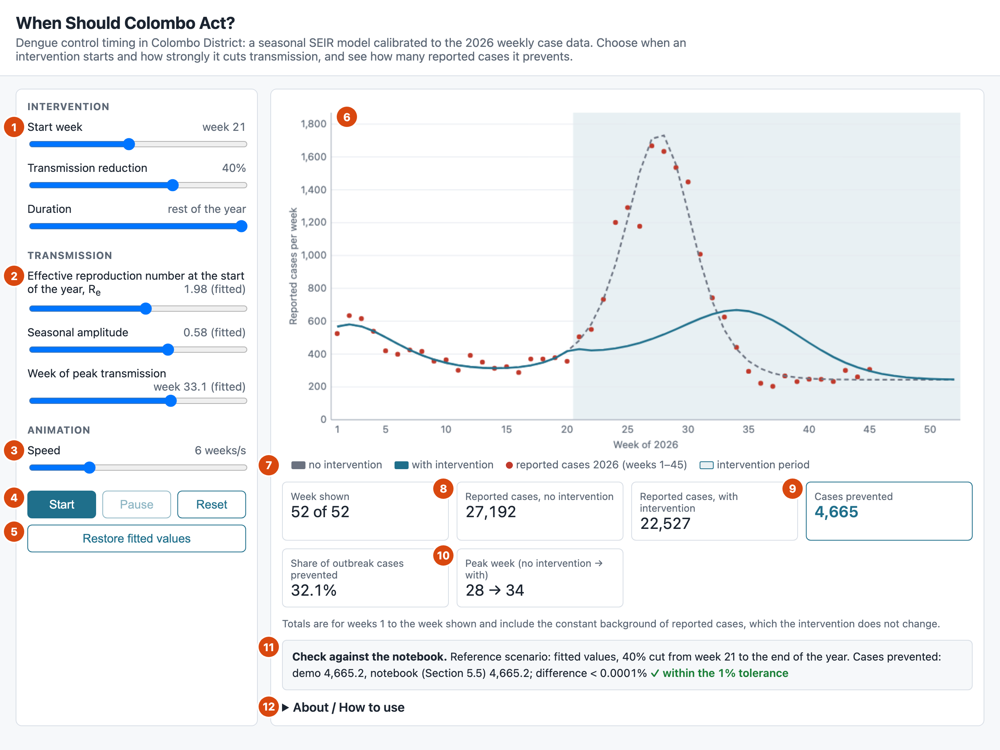

# User guide: When Should Colombo Act? web demo

The demo lets you choose **when** a dengue-control intervention starts in Colombo District and **how strongly** it cuts transmission, and shows how many reported cases it would have prevented in 2026. It runs the same seasonal SEIR model as the project notebook, set to the values calibrated to the 2026 weekly case data.

## Opening the demo

- **Online:** [https://it23226814.github.io/colombo-dengue-control-timing/](https://it23226814.github.io/colombo-dengue-control-timing/)
- **Offline:** download the repository (*Code → Download ZIP*), unzip it, and double-click `docs/index.html`.

It runs entirely in your browser; nothing is installed or uploaded. It has been tested in Chrome and opens and computes correctly in current Edge and Firefox. It also works on a phone, where the controls appear above the chart.

## Controls

The numbers refer to the labels in the screenshot.

| # | Control | What it does | Range | Default |
|---|---|---|---|---|
| 1 | **Start week** | Week of 2026 in which the intervention begins | weeks 1–45 | 21 (the week cases began to rise) |
| 1 | **Transmission reduction** | How much the intervention cuts transmission while it is active (vector control, clean-up campaigns, bite protection, combined) | 0–60% | 40% |
| 1 | **Duration** | How long the intervention lasts. If it reaches week 52, the label reads "rest of the year" | 1–52 weeks | rest of the year |
| 2 | **Effective reproduction number, Re** | Average number of new infections caused by one infectious person at the start of the year. Higher means faster spread | 0.8–3.0 | 1.98 (fitted) |
| 2 | **Seasonal amplitude** | How strongly transmission rises and falls over the year: 0 = no season, 0.9 = very strong season | 0–0.9 | 0.58 (fitted) |
| 2 | **Week of peak transmission** | Week in which the seasonal transmission rate is highest | weeks 10–45 | 33.1 (fitted) |
| 3 | **Speed** | Animation speed | 1–20 weeks per second | 6 |
| 4 | **Start / Pause / Reset** | *Start* replays the year week by week; *Pause* stops it; *Reset* goes back to week 1 | — | — |
| 5 | **Restore fitted values** | Puts every slider back to its calibrated default | — | — |

**Fitted values.** Until you move a transmission slider, it uses the exact calibrated value, and the label says "(fitted)".

**Fixed values.** The remaining model values cannot be changed in the demo:
- the incubation period (5.9 days) and infectious period (5 days);
- the population (2,375,415);
- the susceptible fraction, reporting rate, initial infections and background, which stay at their fitted values.

## Reading the outputs

- **Chart (6) and legend (7).**
  - Weekly reported dengue cases across 2026.
  - The **grey dashed line** is the model with no intervention.
  - The **blue line** is the model with your intervention.
  - **Red dots** are the cases actually reported in weeks 1–45 of 2026.
  - The **shaded band** marks the weeks when the intervention is active.
  - During an animation, a dotted vertical line marks the current week.
- **Week shown.** How far the animation has got. The totals below count weeks 1 up to this week.
- **Reported cases, no intervention (8) and with intervention.** Total reported cases up to the week shown. Both include a constant background of about 243 cases per week, which the intervention does not change.
- **Cases prevented (9).** The difference between the two totals: reported cases the intervention avoids. A **negative** number means the intervention *adds* cases; see *Try this*, step 3.
- **Share of outbreak cases prevented.** Cases prevented as a percentage of the outbreak's own cases, that is the total without intervention minus the background.
- **Peak week (10).** The week with the most reported cases over the whole year, without → with the intervention.
- **Check against the notebook (11).** Explained in the next section.
- **About / How to use (12).** A short version of this guide inside the demo.

**Uncertainty.** All numbers come from one parameter set, the calibration's best-fitting one. The demo shows no uncertainty bands. In the notebook the same 40%-from-week-21 scenario has a posterior median of 4,689 cases prevented, with a 95% credible interval of 3,418–6,108. Read the demo's numbers as central estimates with roughly ±25–30% uncertainty.

## Try this

Start each step from the defaults: press **Restore fitted values**, and set the duration to "rest of the year" when it says so.

1. **Earlier is better for a strong, sustained cut.** Keep the reduction at 40% and the duration at the rest of the year, and move the start week:

   | Start week | Cases prevented | Share of the outbreak |
   |---|---|---|
   | 5 | 7,390 | 50.8% |
   | 13 | 6,046 | 41.6% |
   | 21 (default) | 4,665 | 32.1% |
   | 25 | 3,666 | 25.2% |
   | 29 | 1,337 | 9.2% |

   After the rise, each week of delay costs roughly 250–600 cases. Press **Start** to watch the blue line split from the grey one in the start week.
2. **A weak cut gains little from starting early.** Set the reduction to 10%. Starting in week 5 prevents 252 cases, while weeks 21 and 25 prevent 544 and 551. A weak cut cannot stop the outbreak; started early, it mainly delays it.
3. **A short campaign must hit the outbreak.** Set the reduction to 40% and the duration to 8 weeks.
   - Started in week 5, the campaign *adds* 455 cases (cases prevented −455). It only postpones the outbreak into the stronger part of the season.
   - Started in week 25, just before the peak, it prevents 1,636 cases.
4. **Explore the transmission settings.** Drag Re down to 1.5. The outbreak without intervention becomes smaller and later (peak week 34), and the same 40% cut from week 21 now prevents about 80% of it. Press *Restore fitted values* when done.

## Check against the notebook

The box under the results, **Check against the notebook**, always recomputes one reference scenario, whatever the sliders show:
- **Scenario:** the fitted values, with a 40% cut in transmission from week 21 to the end of the year.
- **Result:** the cases prevented, shown beside the value the notebook computes for exactly the same parameters (notebook Section 5.5).

| Reference scenario | Notebook (Section 5.5) | Demo | Tolerance |
|---|---|---|---|
| Fitted values, 40% cut from week 21 to week 52 | 4,665.2 reported cases prevented | 4,665.2 | within 1% (the two agree to better than 0.0001%) |

You can also reproduce it with the sliders. Press *Restore fitted values*, leave the start week at 21, the reduction at 40% and the duration at "rest of the year". The *Cases prevented* box then shows **4,665**.

This is one parameter set. The notebook's posterior median over 2,000 samples for the same scenario is 4,689, with a 95% credible interval of 3,418–6,108.

## Limitations

- **One parameter set, no uncertainty.** The demo uses the single best-fitting parameter set. The notebook propagates 2,000 posterior samples and gives credible intervals (Section 5.1); use those for any statement about uncertainty.
- **No mosquitoes, cosine season.** The demo uses the host-only SEIR model with a cosine-shaped season. The notebook's rainfall-driven host–vector model (Section 5.4) agrees that a strong sustained cut should start at or before the rise, and that short campaigns work best just before the peak. It does **not** reproduce the finding that early weak or short measures add cases (*Try this*, steps 2–3). Treat that finding as model-dependent.
- **Calibrated only near the fitted values.** The data support Re between about 1.78 and 2.14, a seasonal amplitude between 0.54 and 0.62, and a peak week between 31.5 and 34.1 (95% credible intervals). Results far outside these ranges are extrapolations of the model, not estimates for Colombo.
- **Other values are fixed.** The susceptible fraction, reporting rate, initial infections and background cannot be changed. When you move a transmission slider, the model keeps them at their fitted values, so the outbreak no longer matches the 2026 data.
- **A simplified intervention.** The intervention is a single percentage cut in transmission. It does not model specific measures, costs, coverage, or how long it takes for a measure to have an effect. The background of reported cases is assumed not to change.
- **2026 only.** The horizon is weeks 1–52 of 2026. Effects on later years are not shown, though the notebook checks they are small for these scenarios. Counts are *suspected* cases as reported, not laboratory-confirmed infections.
